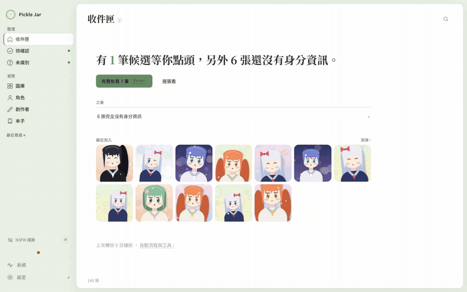
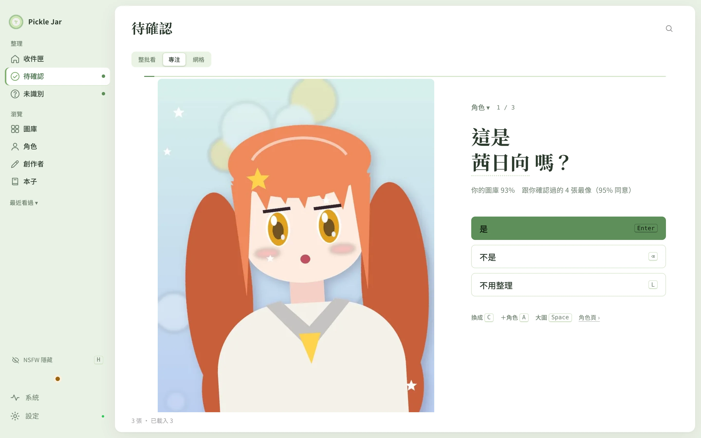
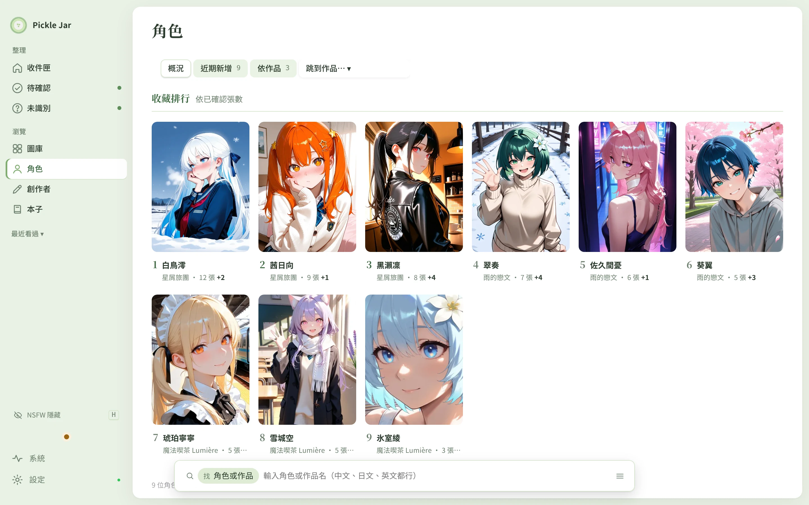
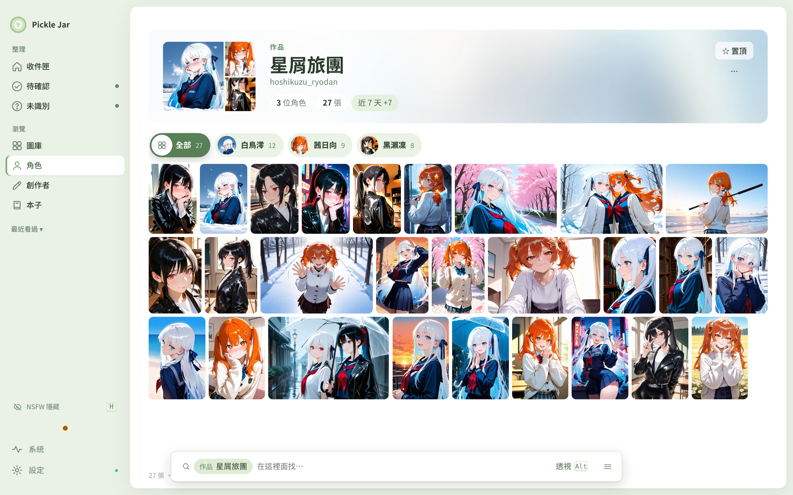
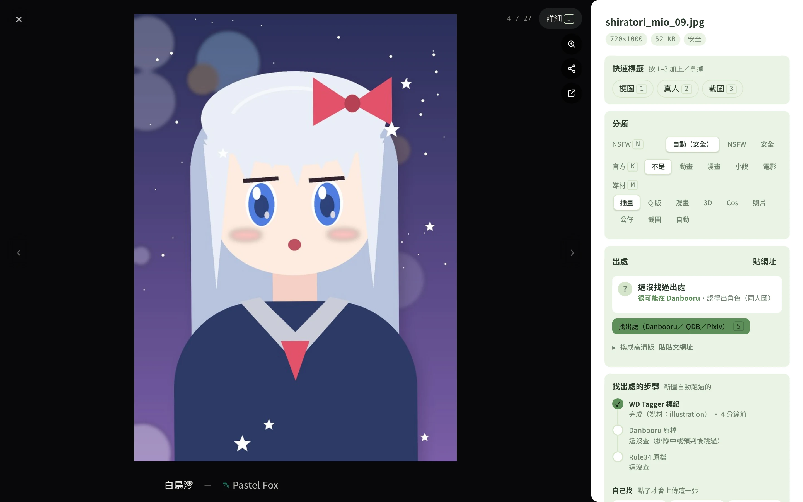
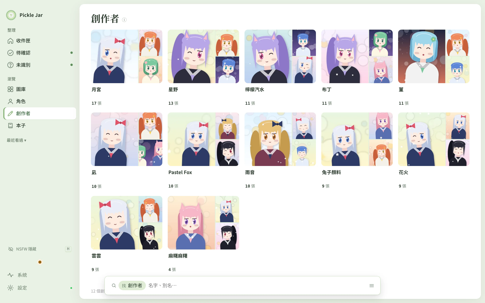
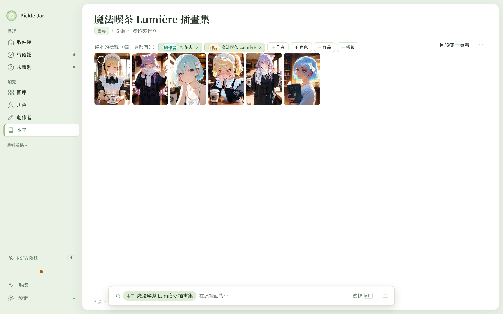
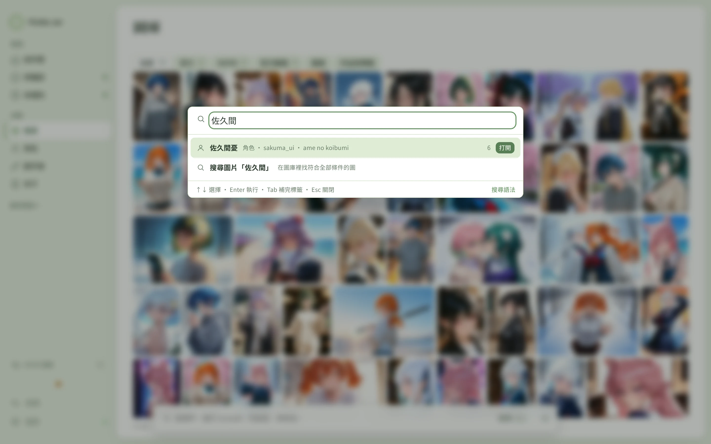
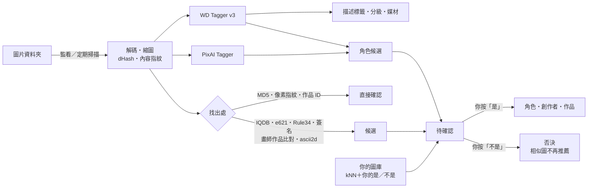

<div align="center">

# Pickle Jar

**本機執行的插畫／圖片圖庫整理工具**<br>
自動標記、找出處、辨認角色和創作者——所有判斷由你確認才算數


[](https://github.com/Esheep57/pickle-jar/actions/workflows/tests.yml)



<sub>38 秒操作示範（<a href="docs/media/demo.mp4">高畫質 MP4</a>）。示範用的圖是 AI 生成的原創角色，角色、作品、創作者都是虛構的。</sub>

</div>

> **English** — Pickle Jar is a local-first organizer for anime-style illustration libraries (thousands to tens of thousands of images on your own disk). It tags images on your machine with WD Tagger v3 / PixAI Tagger (ONNX, GPU optional), finds sources on Danbooru, Pixiv and others, and suggests characters, artists and series — but nothing counts until you confirm it. The UI and docs are in Traditional Chinese (a Simplified Chinese mode is built in). Licensed under GPL-3.0.
>
> **Highlights**: confirm-first review queue (batch / focus / grid modes) · source finding by MD5, pixel fingerprint, Pixiv/X IDs, IQDB and semi-automatic ascii2d · character shelf, series pages, artist cards, albums for doujinshi and Pixiv manga · official Chinese character names for major games · import from X, Pixiv, Danbooru, e621, Rule34, E-Hentai, nhentai and any site [gallery-dl](https://github.com/mikf/gallery-dl) supports · keyboard-first, Ctrl+K command palette · read-only phone view on your LAN.
>
> **Quick start**: Python 3.12 → download or `git clone` this repo → run `start.bat` (Windows) or `./start.sh` (macOS / Linux) → open http://127.0.0.1:7860 and add your image folders. The first run downloads the tagger model (~1.2 GB). FastAPI + SQLite backend, vanilla ES-module frontend; Windows-first, macOS and Linux supported. Bug reports and questions in English are welcome.

Pickle Jar 管理的是存在你自己硬碟裡的幾千到幾萬張圖：手機從 X 存下來的同人圖、Pixiv 收藏、Danbooru 原圖、同人本、梗圖、截圖、照片和影片。它用 [WD Tagger v3](https://huggingface.co/SmilingWolf/wd-eva02-large-tagger-v3) 和 PixAI Tagger v1.0 在本機自動打標籤、認角色，再到 Danbooru、Pixiv 等網站找出處，把角色、創作者、作品整理出來。

設計原則有三個：

- **你確認才算數**：AI 和搜源的結果都先進「待確認」；你否決過、手動改過的，任何自動流程都不會蓋掉。
- **每一步都看得到、都能調**：每張圖跑過哪些步驟、結果是什麼都查得到；每個自動步驟都能單獨開關、決定「找到時直接確認／放待確認／只記下」、調門檻，旁邊是用你自己按過的是／不是算出來的準確度。
- **不動你的檔案**：圖片留在原本的資料夾。只有你按「刪除」（丟進資源回收筒）、「移出 iCloud」、「換成高清」時才會動到檔案。

---

## 畫面

<table>
<tr>
<td width="50%"><br><b>收件匣</b>：一句話告訴你現在該做什麼，按 Enter 開始</td>
<td width="50%"><br><b>待確認</b>：「這是 ○○ 嗎？」Enter 是、⌫ 不是，附上依據</td>
</tr>
<tr>
<td><br><b>角色</b>：收藏排行、近期新增、依作品分組</td>
<td><br><b>作品頁</b>：這部作品的角色和全部的圖</td>
</tr>
<tr>
<td><br><b>大圖工作台</b>：角色 — 創作者字幕、分類、出處、每一步的紀錄</td>
<td><br><b>創作者</b>：每位作者一張拼貼卡，照張數排</td>
</tr>
<tr>
<td><br><b>本子</b>：同人本、畫集、cos 圖包，整本加標籤、照頁序看</td>
<td><br><b>Ctrl+K</b>：中日英文名、簡繁體都找得到</td>
</tr>
</table>

---

## 目錄

- [畫面](#畫面)
- [主要功能](#主要功能)
- [運作方式](#運作方式)
- [系統需求](#系統需求)
- [安裝與啟動](#安裝與啟動)
- [第一次使用](#第一次使用)
- [會連到哪些網站](#會連到哪些網站)
- [資料與備份](#資料與備份)
- [專案結構](#專案結構)
- [開發](#開發)
- [文件](#文件)
- [已知限制](#已知限制)
- [致謝](#致謝)

---

## 主要功能

### 自動標記
- **WD Tagger v3（EVA02-Large）**：描述標籤（長髮、制服…）、分級（NSFW）、角色候選；有 GPU 就用 GPU（DirectML、CUDA），沒有就用 CPU
- **PixAI Tagger v1.0**：第二個模型，資料比較新（8,308 個角色、4,917 位畫師的畫風）；在獨立的子程式裡跑，模型出問題也不會讓整個程式當掉
- **你的圖庫（新角色辨識）**：兩個模型都不認得的角色，用你確認過的圖做 kNN 推薦，並從你的「是／不是」學習
- **影片**：均勻抽 4–12 幀一起標記，再彙總
- **格式**：JPG、PNG、WebP、GIF、AVIF、HEIC／HEIF；iPhone 原況照片附帶的 `.MOV` 自動略過
- **監看資料夾**：新檔案進來自動處理，新的先做；搬家、改名用內容指紋接回，不會掉標記

### 找出處
- **確定的方法**（直接確認）：Danbooru 原檔 MD5、像素指紋、檔名裡的 Pixiv 作品 ID、推文 ID、X 圖片編號
- **相似圖**（進待確認）：Danbooru 以圖搜圖／IQDB；70–90% 的灰色地帶會下載原圖比對
- **其他來源**：e621、Rule34 原檔比對；讀圖上的簽名（@帳號、網址）
- **畫師作品比對**：拿已知畫師在 Pixiv（和 X 的媒體頁）上的全部作品縮圖，跟還沒找到出處的圖比
- **ascii2d 半自動**：Danbooru 沒收的 X／Pixiv 原創圖，由油猴腳本在你的瀏覽器裡一張一張送，程式負責比對；夠像可以自動確認，都不像自動跳過
- **搜源前先預判**：梗圖、截圖、照片、本機 AI 生成的圖不上傳以圖搜圖
- **每一步的設定集中一處**（設定 › 自動標記與搜源）；改了設定，用「補跑」選範圍和步驟套用到舊圖

### 整理
- **待確認**三種模式：**整批看**（AI 0.9 分以上的同一個名字排成一面，只挑錯的）、**專注**（「這是 ○○ 嗎？」一張一張看）、**網格**（多選、批次）
- **大圖工作台**：全鍵盤（Enter 是、⌫ 不是、Shift+Enter 全部是、A／R／G 加角色／創作者／標籤、L 不用整理…）；在待確認頁處理完自動跳下一張
- **多人圖**：估計人數、提醒還有誰沒標；本體和造型（例如初期衣裝）算同一個人；Pixiv 多頁作品可以用一張表逐頁標角色
- **未識別分流**：完全未識別、缺角色、缺創作者、多人圖缺角色；梗圖、有字、照片、漫畫自動分堆，可以整堆標「不用整理」
- **快速標籤**：梗圖、截圖、真人等常用分類按數字鍵 1–9；標了梗圖、截圖的不再認角色、不再要你確認
- **本子**：同人本、cos 圖包、畫集當成一本：整本加標籤、智慧頁序（好幾本合成一本會分本、照集數排）、拖曳調頁序；本子裡的圖不會被自動推薦或送去搜源
- **官方作品**：動畫、漫畫、電影截圖和小說插圖，跟同人圖分開，都算已經有作者
- **重複**：只算「看起來一模一樣」的圖和局部截圖，改了表情或對話的差分不算
- **標籤蘊含**：「A 也代表 B」（造型 ⇒ 本體、表情包 ⇒ 梗圖）：確認 A 自動帶上 B；Danbooru 的規則自動抓，自己也能訂、能關
- **換成高清版**：出處有同一張、而且比較大的版本時提醒你；換之前逐像素確認是同一張
- **中文名**：遊戲角色優先用官方譯名（FGO、寶可夢、聖火降魔錄、碧藍航線、蔚藍檔案、賽馬娘、明日方舟、少女前線、NIKKE、原神、星穹鐵道、絕區零、遊戲王、碧藍幻想、闇影詩章、英雄聯盟、鬥陣特攻…，台灣／大陸各自的官方名），其他來自 Bangumi、Wikidata、維基百科；沒有中文時顯示英文。不同作品同名的角色名字後面加作品名（紫苑（碧藍幻想））；變身名附本名（Cure Peace（黃瀨彌生））
- **子作品分開顯示**：Danbooru 上被歸成子標籤的作品（明日方舟：終末地、電馭叛客的遊戲和動畫各季）可以各自一個作品頁；角色照 Danbooru 上的比例判斷屬於哪邊，兩邊都有的兩邊都列
- **操作紀錄**：每個改資料的操作都記一筆、一直留著（撤銷只留最後 100 筆），看得到每天做了什麼、最常做的動作、用鍵盤還是滑鼠，可以下載 CSV

### 瀏覽
- **每一頁同一個骨架**：上面是這頁是什麼（標題、頁內分頁），下面是同一條查詢列（條件 token＋分面面板＋≡），選了圖就換成動作列
- **搜尋語法**：`hatsune_miku -tag:梗圖 date:2024 w:>=1920 chars:>=2 is:multi series:blue_archive`，中日英文名、簡繁體都查得到
- **角色書架、作品頁、創作者拼貼卡**、本子書封、智慧相簿（存起來的搜尋）、指令面板（Ctrl+K）
- **NSFW**：隱藏／模糊／顯示三段切換，隱藏時連側欄數字、封面都不會出現
- **從網站匯入**：油猴腳本在 X、Pixiv（可以只選其中幾頁）、Danbooru、e621、Rule34 的貼文上加一顆按鈕，下載原圖並記下出處和作者；Pixiv 的多頁作品可以一鍵存成本子；E-Hentai、nhentai 整本匯入並自動建立本子；其他網站（Bluesky、DeviantArt、Gelbooru…）交給 [gallery-dl](https://github.com/mikf/gallery-dl)
- **匯出訓練集**：選的圖複製到資料夾，每張旁邊一個 `.txt` 標註（你確認過的角色、作品、創作者＋描述標籤），給 LoRA 訓練用
- **Danbooru 角色表**：下載 Danbooru 上的角色清單（約 10 萬個），加標籤時也挑得到圖庫裡還沒有的角色；中文名照作品熱度在背景查
- **繁體／简体**：設定裡一鍵切換简体模式——不只簡繁轉換，介面用大陸用語、角色和作品用大陸譯名
- **手機／平板**：同一個 Wi-Fi 下輸入 PIN，可以看圖庫（只能看，滑動換張、兩指縮放）和上傳

---

## 運作方式



身分標籤的可信度順位（高的先）：

| 順位 | 來源 | 預設怎麼處理 |
|---|---|---|
| 1 | Danbooru 原檔 MD5、像素指紋、Pixiv／推文 ID；畫師作品比對找到的畫師 | 直接確認 |
| 2 | Danbooru／IQDB 相似圖（≥ 90%，或下載比對過） | 待確認 |
| 3 | Pixiv 作者（Pixiv 標籤推的角色、作品預設只記下）；AI 生成圖的提示詞（直接確認） | 待確認 |
| 4 | WD Tagger、PixAI、你的圖庫（kNN） | 待確認（PixAI 預設只記下）；找到出處就收掉 |

每一步「找到時怎麼辦」都可以在 設定 › 自動標記與搜源 改（直接確認／放待確認／只記下）。預設的門檻是開發時拿一個實際圖庫量出來的（例如 WD 角色門檻 0.85 時約 89% 正確）；設定頁會用**你自己**按過的是／不是算出每一步在你的圖庫上多準。

---

## 系統需求

| 項目 | 需求 |
|---|---|
| 作業系統 | Windows 10／11（主要平台）；macOS、Linux 可以跑 |
| Python | 3.12（`start.bat` 會自己準備，不用先裝） |
| 記憶體 | 建議 8 GB 以上（開 PixAI 建議 16 GB） |
| GPU | 選用。任何支援 DirectX 12 的顯卡（DirectML），或 NVIDIA（CUDA） |
| 硬碟 | WD Tagger 下載約 1.2 GB（`models/` 展開後約 2.4 GB）；PixAI 另外約 950 MB；縮圖快取每萬張約 0.5 GB |
| 瀏覽器 | Chrome、Edge、Firefox 新版 |
| 網路 | 第一次下載模型時需要；之後只有開啟線上功能時才連網 |

---

## 安裝與啟動

### Windows

```bat
git clone https://github.com/Esheep57/pickle-jar.git
cd pickle-jar
start.bat
```

沒有裝 git 也可以：在這個頁面右上角按 **Code → Download ZIP**，解壓縮到想放的地方（例如 `D:\pickle-jar`，路徑裡最好不要有 OneDrive 這類同步資料夾），雙擊裡面的 `start.bat`。

`start.bat` 做的事：

1. 下載 [uv](https://docs.astral.sh/uv/)，在程式資料夾裡準備一份獨立的 Python 3.12（放在 `tools/`、`.venv/`，不影響電腦上其他的 Python）
2. 依 `requirements.txt` 安裝固定版本的套件，再加上 `onnxruntime-directml`
3. 啟動伺服器，打開 `http://127.0.0.1:7860/`

之後雙擊 `start.bat` 就能啟動。`requirements.txt` 有變動時，它會自動重新安裝套件。

**GPU**：預設用 DirectML，不用另外裝 CUDA。想改用 CUDA 就執行 `use-cuda.bat`，要改回來就執行 `use-directml.bat`。目前用的是哪一個、每秒幾張，在 系統 › 系統狀態 →「模型健檢／測速」可以看到。

### macOS／Linux

```sh
./start.sh            # 有 uv 就用 uv，沒有就用系統的 python3
```

### 啟動參數

```sh
python run.py --port 7860 --no-browser
```

伺服器只接受本機連線（`127.0.0.1`）。開啟「手機／平板」並設了 PIN 之後，區網裡只開放 `/m` 和看圖需要的唯讀 API；確認、刪除這些整理的動作、設定、金鑰、備份都不給區網。

更新程式後要**重新啟動**（Ctrl+K →「重新啟動程式」，或關掉 `start.bat` 的視窗再開），新程式和資料庫升級才會生效。

---

## 第一次使用

1. **設定精靈**：選圖庫資料夾、選模型、選線上功能和 NSFW 預設
2. **下載模型**：在背景下載（約 1.2 GB），右上角有進度。下載慢的話可以在設定填鏡像（例如 `https://hf-mirror.com`），也可以手動放到 `models/SmilingWolf__wd-eva02-large-tagger-v3/`
3. **建議填 Danbooru API key**（免費）：沒有 key 時以圖搜圖只能用公開的 IQDB，一張要 30–60 秒；填了以後快很多。[註冊](https://danbooru.donmai.us/users/new) → [API Keys](https://danbooru.donmai.us/api_keys) → 貼到 設定 › 網站帳號
4. **設定異地備份**：設定 › 資料與備份 ›「備份另存一份到」選另一顆硬碟或雲端資料夾
5. 從**收件匣**開始：它會告訴你現在最該做什麼

各功能的詳細用法見 **[使用手冊](docs/USER_GUIDE.md)**。

---

## 會連到哪些網站

所有標記、比對都在本機做。下面這些只有在你開啟對應的功能時才會連線；每一項都能在 設定 › 自動標記與搜源 單獨關掉，也有一個線上功能總開關。

| 服務 | 用途 | 送出什麼 |
|---|---|---|
| Hugging Face | 第一次下載 WD Tagger、PixAI 模型 | 不送資料 |
| Danbooru | 原檔比對、角色資料卡、相似圖 | 檔案 MD5、像素指紋；以圖搜圖時送縮小的圖 |
| IQDB | 相似圖 | 縮小成 1000px 的圖（真人照片、本機 AI 圖不送） |
| Pixiv | 作品資訊、作者、標籤、原圖尺寸；畫師作品比對下載作品縮圖 | 作品 ID、畫師 ID |
| FxTwitter | X 貼文的作者、圖片 | 推文 ID |
| e621、Rule34 | 原檔比對（e621 也可以以圖搜圖） | 檔案 MD5；e621 以圖搜圖時送縮小的圖 |
| E-Hentai | 整本匯入 | 不送資料（只讀網頁、下載你按的那本） |
| Bangumi、Wikidata、維基百科 | 角色和作品的中文名 | 角色名、作品名 |
| nhentai | 匯入 | 不送資料（只下載你按的那篇） |
| gallery-dl 支援的其他網站 | 你貼的貼文網址（下載原圖） | 由 gallery-dl 照它自己的設定（cookie）連線 |
| ascii2d、X 媒體頁 | 半自動找出處、X 的畫師作品比對 | 由**你的瀏覽器**操作，程式本身不連 |
| SauceNAO、TinEye、Fluffle | 手動以圖搜圖 | 你按了才送這一張 |

API key、Pixiv cookie 只存在本機的 `data/library.db`，不會寫進匯出檔或記錄檔，也不給手機看。安全上的做法（只收本機連線、檢查 Host、擋跨站請求、匯入網址白名單）見 [DEVELOPMENT.md](docs/DEVELOPMENT.md) 的「安全」。

---

## 資料與備份

| 路徑 | 內容 | 版本控制 |
|---|---|---|
| `data/library.db` | SQLite（WAL）：標籤、確認紀錄、特徵向量、設定、操作紀錄 | ✗ |
| `data/backups/` | 每天自動備份，保留 7 份（可以另存一份到別的硬碟） | ✗ |
| `data/thumbs/`、`data/preview/` | 縮圖、轉檔快取，刪掉會重建 | ✗ |
| `data/errors.log`、`data/crash.log` | 程式出錯紀錄（系統 › 系統狀態看得到） | ✗ |
| `models/` | WD Tagger、PixAI、OCR 模型 | ✗ |
| `tools/`、`.venv/` | `start.bat` 準備的 Python 和套件 | ✗ |

- **搬家、改名**：用內容指紋接回，確認過的標記都保留
- **刪除**：丟到資源回收筒，紀錄保留 30 天；檔案還原回來就自動接回
- **大量消失保護**：一次有很多張突然找不到（iCloud 同步中、隨身碟沒插）時，先問你，不會直接標成「找不到」
- **撤銷**：大部分的動作都能用 Ctrl+Z 撤銷（最後 100 個）；每個操作另外記在**操作紀錄**裡，一直留著
- **匯出／匯入**：你手動做的判斷可以匯出成 JSON，換電腦時用指紋對應匯回
- **XMP 側車檔**：可以在圖片旁邊寫 `.xmp`，Lightroom、digiKam、Eagle 讀得到

---

## 專案結構

```
pickle-jar/
├── run.py                 進入點（參數：--port、--no-browser）
├── start.bat / start.sh   一鍵安裝＋啟動
├── app/
│   ├── server.py          FastAPI、安全檢查、啟動時的背景整理
│   ├── db.py              SQLite 連線、版本遷移（PRAGMA user_version）、撤銷、操作紀錄、備份
│   ├── pipeline.py        掃描、監看、標記、同圖判斷
│   ├── tagger.py          WD Tagger（ONNX）
│   ├── pixai.py           PixAI Tagger（推論在子程式 pixai_worker.py）
│   ├── steps.py           自動標記與搜源的每一步：開關、找到時怎麼辦、門檻
│   ├── candidates.py      候選與可信度順位（所有自動標籤都經過這裡）
│   ├── online.py          搜源流程（httpclient / danbooru / pixiv / e621 / r34）
│   ├── charknn.py         新角色辨識（kNN＋從你的是／不是學習）
│   ├── ascii2d.py         ascii2d 半自動找出處
│   ├── sweep.py           畫師作品比對（Pixiv、X）
│   ├── importer.py        從網站匯入（galleries.py：E-Hentai、nhentai 整本）
│   ├── albums.py          本子：整本標籤、頁序
│   ├── gdl.py             其他網站交給 gallery-dl
│   ├── implies.py         標籤蘊含（A 也代表 B）
│   ├── dataset.py         匯出訓練集（圖片＋.txt 標註）
│   ├── upgrade.py         換成高清版
│   ├── zhname.py          中文名（Bangumi、Wikidata）
│   ├── query.py           搜尋語法
│   ├── jobqueue.py        存在資料庫裡的線上工作佇列（重開程式接著做）
│   ├── maintenance.py     每 6 小時的定期整理
│   └── api/               各頁的 API 路由
├── static/
│   ├── index.html
│   ├── style.css          依功能分段的樣式表（設計規則見 DESIGN.md，分段規則見 docs/DEVELOPMENT.md）
│   ├── fonts/             思源黑體、思源宋體（離線）
│   └── js/                前端 ES modules（main.js 是入口）
├── tests/                 pytest＋Playwright 畫面測試、假模型、假的線上服務
├── scripts/jscheck.js     前端靜態檢查（需要 Node）
├── docs/                  使用手冊、工程文件、變更紀錄、審查報告
└── DESIGN.md              設計系統（顏色、字型、元件規則；給改介面的 AI 讀）
```

技術選擇：後端是 FastAPI＋SQLite（WAL），只在本機執行。前端是不用打包工具的原生 ES modules。模型推論用 ONNX Runtime，影像處理用 Pillow、OpenCV。所有寫入都經過同一把寫入鎖（`db.write_lock`）。

---

## 開發

```sh
python -m venv .venv
.venv/bin/pip install -r requirements-dev.txt        # Windows：.venv\Scripts\pip
.venv/bin/python -m playwright install chromium
.venv/bin/python -m pytest -q                        # 約 8–10 分鐘，約 240 項
```

GitHub Actions 每次 push 都會跑全部測試（`.github/workflows/tests.yml`）。

- 測試用很小的假 WD／PixAI 模型（`tests/fakemodel.py`）和假的 Danbooru／IQDB／Pixiv／X／e621／Rule34／E-Hentai（`tests/mock_online.py`），不需要網路或 GPU
- **畫面測試是必跑的**：沒裝 Playwright 或 Chromium 時測試會**失敗**，不會靜靜跳過。真的不能裝的話，設 `LIB_ALLOW_NO_UI=1` 明確跳過
- 防呆測試：每一頁實際打開不能有 JS 錯誤、所有寫入都要在寫入鎖裡、所有寫入 API 收到 12 種亂輸入都不能回 500、畫面上的篩選都要登記、每頁看得到的控制有上限（噪音預算）、樣式表不能有重複選擇器／沒人用的 class／撞名（`tests/test_css.py`）
- 前端檢查：`cd scripts && npm install && node jscheck.js`

慣例：

- **資料庫改結構**：在 `db.MIGRATIONS` 最後面加一個函式，不要改前面的
- **會改資料的 API**：用 `db.push_action()` 記撤銷（會自動記進操作紀錄）；不能撤銷的呼叫 `db.log_op()`
- **前端**：新函式要給別的檔案用就 `export`，HTML 字串裡不寫 `onclick="..."`（模組裡沒有全域函式）
- **樣式**：加在 `style.css` 對應功能的段落、改既有規則就改那一條，不要在檔尾加一段蓋掉前面的；新的 class 名稱先 grep
- **同一件事只有一個實作**：同圖判斷 `same_image`、缺創作者 `_NO_ARTIST`、作品範圍 `_series_sql`、名字 `nameindex`、自動標籤 `candidates.add`
- **圖片尺寸一律讀檔頭**（`media.image_size`），不要用解碼後的大小

模組、資料表、處理流程、安全、踩過的坑：**[docs/DEVELOPMENT.md](docs/DEVELOPMENT.md)**。

---

## 文件

| 文件 | 給誰看 | 內容 |
|---|---|---|
| [使用手冊](docs/USER_GUIDE.md) | 使用者 | 每個功能怎麼用、快捷鍵、搜尋語法、設定 |
| [變更紀錄](docs/CHANGELOG.md) | 使用者 | 各版本有什麼改變 |
| [開發文件](docs/DEVELOPMENT.md) | 開發者 | 模組、資料表、處理流程、安全、測試、經驗教訓 |
| [設計系統](DESIGN.md) | 改介面的人 | 顏色、字型、元件規則 |
| [參與開發](CONTRIBUTING.md) | 想回報問題、送 PR 的人 | 怎麼回報、怎麼跑測試、程式和 commit 的寫法 |
| [安全性](SECURITY.md) | 發現安全問題的人 | 怎麼私下回報、哪些算安全問題 |

---

## 已知限制

- **ascii2d 不能全自動**：它有 Cloudflare 機器人驗證，Pickle Jar 不做繞過，只能半自動，由你在瀏覽器裡一張一張按
- **Google Lens、Bing、Yandex** 不接受程式送圖，只能下載後自己拖進網頁
- **X 上最大的就是 X 的原圖**：想要更大的版本，要靠 ascii2d 找到 Pixiv 上的同一張
- **X 的畫師作品比對、nhentai 匯入**要在你的瀏覽器裡做（要登入、或網站會擋程式）
- **換成高清版**換了之後不能用 Ctrl+Z 撤銷（舊檔在資源回收筒）
- 介面是繁體中文和简体中文（简体模式用大陸用語和大陸譯名），沒有其他語言

---

## 致謝

- [SmilingWolf/wd-eva02-large-tagger-v3](https://huggingface.co/SmilingWolf/wd-eva02-large-tagger-v3)、PixAI Tagger v1.0（ONNX 轉檔 [Mexes/pixai-tagger-v1.0-onnx-fp32-fp16-int8](https://huggingface.co/Mexes/pixai-tagger-v1.0-onnx-fp32-fp16-int8)）：標記模型
- [Danbooru](https://danbooru.donmai.us/)、[IQDB](https://iqdb.org/)、[e621](https://e621.net/)、[Rule34](https://rule34.xxx/)、[Pixiv](https://www.pixiv.net/)、[ascii2d](https://ascii2d.net/)、[E-Hentai](https://e-hentai.org/)：出處與標籤資料
- [FxTwitter](https://github.com/FixTweet/FxTwitter)、[Bangumi](https://bgm.tv/)、[Wikidata](https://www.wikidata.org/)、[gallery-dl](https://github.com/mikf/gallery-dl)（nhentai 的做法參考）
- [Xenova/clip-vit-base-patch32](https://huggingface.co/Xenova/clip-vit-base-patch32)（CLIP，媒材判斷）、[RapidOCR](https://github.com/RapidAI/RapidOCR)（簽名辨識）、[OpenCC](https://github.com/BYVoid/OpenCC)（簡繁轉換）、[Noto Sans／Serif TC](https://fonts.google.com/noto)（字型，OFL）
- 官方中文譯名的資料：[Atlas Academy](https://atlasacademy.io/)（FGO）、[神奇寶貝百科](https://wiki.52poke.com/)、[feh-assets-json](https://github.com/HertzDevil/feh-assets-json)、[AzurLaneData](https://github.com/AzurLaneTools/AzurLaneData)、[ArknightsGameData](https://github.com/Kengxxiao/ArknightsGameData)、[SchaleDB](https://schaledb.com/)、[GameTora](https://gametora.com/)、[EnkaNetwork API-docs](https://github.com/EnkaNetwork/API-docs)、[StarRailRes](https://github.com/Mar-7th/StarRailRes)、[deepghs/game_characters](https://huggingface.co/datasets/deepghs/game_characters)、[百鴿 ygocdb](https://ygocdb.com/)、[Data Dragon](https://developer.riotgames.com/docs/lol#data-dragon)、各遊戲官網（闇影詩章、碧藍幻想 Relink、鬥陣特攻）、[萌娘百科](https://zh.moegirl.org.cn/)、[BWIKI](https://wiki.biligame.com/)
- [uv](https://github.com/astral-sh/uv)、[FastAPI](https://fastapi.tiangolo.com/)、[ONNX Runtime](https://onnxruntime.ai/)

模型不包含在這個 repo 裡：第一次使用時從 Hugging Face 下載，各模型的授權請見它們各自的頁面。

使用線上服務時請遵守各網站的使用條款和速率限制。Pickle Jar 對每個網站都有各自的限速，遇到 429 會自動退避。

## 使用聲明

- Pickle Jar 是整理**你自己電腦上的圖**的工具。從網站匯入的功能只應該用在你有權存取、而且網站允許下載的內容上；請遵守各網站的使用條款和創作者的意願，不要拿來散布別人的作品。
- 不支援付費內容平台（FANBOX 等）和付費內容的轉貼站。
- 程式不繞過任何網站的登入、付費牆或機器人驗證（例如 ascii2d 只能在你的瀏覽器裡半自動操作）。

## 開發方式

這個專案大部分的程式碼和文件是跟 [Claude](https://claude.ai)（Anthropic 的 AI）一起寫的：需求、取捨和每個判斷由作者決定，程式由 Claude 撰寫、測試。

## 授權

[GPL-3.0](LICENSE)。你可以自由使用、修改、散布；散布修改過的版本時，也必須以 GPL-3.0 公開原始碼。

字型（Noto Sans／Serif TC）是 SIL Open Font License，授權檔在 `static/fonts/` 各資料夾裡。
